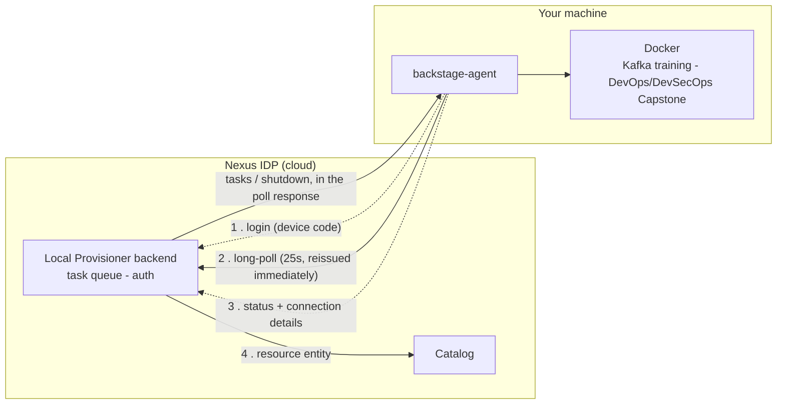

# Local Provisioner

The Local Provisioner lets you spin up guided training environments (Kafka, DevOps/DevSecOps
Capstone) on your own machine via Docker Compose — without needing to configure anything
manually.

---

## How It Works

1. You install the `backstage-agent` CLI on your machine
2. The agent connects to Nexus IDP and listens for provisioning tasks
3. You request a resource from the Nexus IDP UI
4. The agent runs the Docker Compose stack on your machine and reports status back

Your machine must be running and the agent must be active for provisioning to work.

---

## Architecture

The portal runs in the cloud; Docker runs on your laptop. Since the portal can't reach into your
machine, the agent **pulls** work: it holds a long-poll request (`GET /agent/poll`) open against
the backend, which responds the instant work exists — or after 25s if there's nothing to deliver
— and the agent immediately reissues the request. This single endpoint carries task delivery,
liveness (each call refreshes the agent's "last seen" timestamp — no separate heartbeat), and
shutdown signaling. There's no persistent streaming connection (SSE) — that was replaced with
this approach on 2026-07-26, because the Cloudflare tunnel in front of the portal doesn't
reliably hold a single connection open indefinitely, but handles many short, bounded requests
without issue.



Once a resource is running it needs **no internet** — it's local Docker. Only provisioning (the
one-time image pull) needs a connection. See the
[Local Provisioner Architecture](local-provisioner-architecture.md) doc for the full design
(task lifecycle, data model, catalog integration, security).

---

## Prerequisites

- **Docker**, installed and running. **Docker Desktop is recommended** on macOS and Windows
  ([get it](https://www.docker.com/products/docker-desktop/)); on Linux use
  [Docker Engine](https://docs.docker.com/engine/install/). Open Docker Desktop and wait until it says
  it is running before you start the agent. The agent **will not start without Docker**, and
  `backstage-agent start` tells you what is missing. Either `docker compose` v2 or the legacy
  `docker-compose` binary works; the agent detects whichever is present.
- Node.js 20+
- [Multipass](https://multipass.run/), only for the Linux server labs (your own Ubuntu VM). macOS:
  `brew install --cask multipass`
- Access to Nexus IDP (any authenticated user)

---

## Install the Agent

On macOS and Linux, run the installer. The **My agents** section of the Local Provisioner page shows
this command with your portal's address in it:

```bash
curl -fsSL https://<your-portal>/api/local-provisioner/agent/install.sh | sh
```

That is all: `backstage-agent` works at once, in the window you ran the installer in and in every other
one, in any shell (zsh, bash, fish, sh). The installer puts the agent in `~/.backstage-agent/npm`, writes a
launcher that always runs the agent with the Node that installed it, and links the launcher into a folder
that is already on your PATH (`/opt/homebrew/bin`, `/usr/local/bin`, `~/.local/bin` or `~/bin`). If none of
those can be written, it adds the launcher to your zsh, bash or fish startup file and prints the one line to
run in the current window. Open the same address in a browser to read the script before you run it. To remove the agent again, whichever way you installed it (your login, logs and labs are kept):

```bash
backstage-agent --uninstall
```

It stops the running agent and removes it; if the installer put it there, it also removes the link and the lines
it added to your shell startup files, and leaves the rest of those files as they were. Labs that are running keep
running. Agents older than 0.1.32 do not have this command; for those run
`curl -fsSL https://<your-portal>/api/local-provisioner/agent/install.sh | sh -s -- --uninstall`.

On Windows, or if you prefer npm:

```bash
npm install -g @stratpoint/backstage-agent
```

---

## First-Time Login

The agent uses a device code flow (similar to GitHub CLI):

```bash
backstage-agent login
```

This will:
1. Print a user code (e.g. `ABCD-1234`)
2. Open your browser to the Nexus IDP device auth page
3. You enter the code and authenticate with Google
4. The agent saves a token to `~/.backstage-agent/config.json`

The token is valid for 7 days. When it expires, run `backstage-agent login` again.

---

## Start the Agent

`backstage-agent login` already starts the agent for you as a **background daemon** — it keeps
running after you close the terminal, so you stay online. You only need `start` if you stopped it:

```bash
backstage-agent start     # start the background daemon
backstage-agent status    # verify it's running and connected
backstage-agent stop      # stop it
```

---

## Provisioning a Resource

There is currently **no "Provision resource" dialog wired up in the portal** — an earlier version
of this page had one (`ProvisionDialog`), but it was reverted because it broke access to other
scaffolder templates and was never re-wired. Every resource today is provisioned via a
**scaffolder template**, reachable from the global **Create** page:

1. Go to **Create** in the sidebar, filter by the `training` tag (or search by name)
2. Pick a template: **Provision Kafka Training Environment Locally**, **Provision DevOps Capstone
   App Locally**, or **Provision DevSecOps Capstone App Locally**
3. Fill in the parameters and submit — this queues a task for your agent (via the
   `stratpoint:local-provision` scaffolder action)
4. Your agent picks it up on its next long-poll response (instantly if it's already waiting, which
   it normally is) and starts the Docker Compose stack on your machine
5. When the run succeeds, the portal takes you to your lab in **Local Provisioner** and opens its
   detail view (live setup steps, logs, connection details). If the run fails, you stay on the
   run page, where the steps and the log show what went wrong. The lab is also in the sidebar's
   **Local Provisioner** list at any time: click its row to open the same detail view.
6. **Accept the GitHub invitation.** Your lab's repo is private and shared with you, so GitHub
   sends you an invitation. A toast at the bottom of the page links straight to it
   (**Accept the invitation**); the same **Accept the GitHub invitation** button stays in the
   lab's detail view under *Get the code on your laptop* until the code is on your laptop. Labs
   that mount your repo (the Node.js capstones) cannot start without it: they wait 30 minutes
   for you to accept, then fail. Retry once you have accepted.

Connection details (host, port, connection string) are shown in the task detail view once the
resource is running, with a copy button. The resource also appears in the **catalog** as a
`Resource` entity.

---

## Supported Resources

Only the three templates below are currently reachable. The agent's executor also has
support for plain, standalone Kafka/PostgreSQL/Redis/MongoDB (`templates/kafka`, `templates/postgres`,
`templates/redis`, `templates/mongodb`), but there is no template or UI path that provisions any
of them today — don't expect to find them in the portal.

| Resource | Template | Ports | Notes |
|----------|----------|-------|-------|
| Kafka (training) | `kafka-training-local` | Broker 9092, Zookeeper 2181, Kafka UI 8080, optional Schema Registry/Kafka Connect/Postgres/Prometheus/Grafana | Confluent Platform stack, not the standalone `bitnami/kafka` image — a genuinely different setup from any future plain "kafka" resource |
| DevOps Capstone (training) | `devops-capstone-training-local` | 3000 (frontend), 3001 (backend), 5432 (Postgres) | 3-tier task app, **built from source** on your machine (not a pulled image) — Phase 1 target for the [DevOps/DevSecOps Capstone training](https://github.com/strat-training/devops-capstone-local-provisioning) |
| DevSecOps Capstone (training) | `devsecops-capstone-training-local` | 3000 (frontend), 3001 (backend), 5432 (Postgres) | Same app, built from source — Phase 2 target for the same training, tracked as a separate resource from the Phase 1 one |

Each resource's exact connection string and published ports are shown in the portal's **task
detail view** (click a task row) with a copy button, and are stored locally in
`~/.backstage-agent/resources.json`.

> **Note on the two capstone resources:** these run three containers, so there's no single
> meaningful "connection string" — use the frontend and backend URLs directly
> (`http://localhost:<frontend port>` and `http://localhost:<backend port>`), both shown in the
> task detail view. They also require **agent 0.1.21+** — the template sends the app's source
> tree alongside the compose file (`task.config.sourceFiles`, base64-encoded); earlier agent
> versions only ever received the compose file text and fail with
> `unable to prepare context: path ".../app/backend" not found`. Run `backstage-agent update`
> if you're on an older version.

### Kafka (training)
The full Confluent Platform stack (broker, optional Zookeeper/Schema Registry/Kafka Connect/
monitoring) — see the `kafka-training-local` template's own parameters for what's configurable.

### DevOps Capstone / DevSecOps Capstone (training)
A 3-tier task management app (React frontend, Node.js/Express backend, PostgreSQL) — the target
environment for the [DevOps/DevSecOps Capstone
training](https://github.com/strat-training/devops-capstone-local-provisioning). Unlike Kafka
above, the frontend and backend images are **built from source** on your machine rather than
pulled — that's intentional, building the containers is part of the training. Provision
**DevOps Capstone** to start Phase 1, and **DevSecOps Capstone** to start Phase 2 — they run the
identical app but are tracked as separate resources so each phase's environment has its own
catalog entity and lifecycle. See the training repo's
[`local-provisioning/`](https://github.com/strat-training/devops-capstone-local-provisioning/tree/main/local-provisioning)
guide for the full walkthrough.

---

## Adding more resources & training environments

The catalog of provisionable resources is expected to grow — additional databases, message
brokers, observability stacks, and guided **training environments** (a resource plus a set of
exercises) are on the roadmap. Every resource today goes through a **scaffolder template**
reachable via the global **Create** page — see `kafka-training-local`,
`devops-capstone-training-local`, or `devsecops-capstone-training-local` in
[`engineering-standards`](https://github.com/your-github-org/engineering-standards)
`templates/training/` for the pattern (all three call the `stratpoint:local-provision` scaffolder
action). There's also an unused, dead-code `ProvisionDialog` component
(`plugins/local-provisioner/src/components/ProvisionDialog/`) from an earlier design that
provisioned resources directly from this page without a scaffolder step — it isn't wired into the
UI and shouldn't be treated as a second supported path unless someone deliberately re-wires it.

See the [Bench Engineer Usage Backlog](../bench-engineer-usage-backlog.md) (R-series) for
training-environment tasks, and the
[Local Provisioner Architecture](local-provisioner-architecture.md) doc for how templates,
task types, and the agent executor fit together.

---

## Stopping the Agent

The agent runs in the background, so `Ctrl+C` won't stop it — use:

```bash
backstage-agent stop
```

Stopping the agent does **not** stop your provisioned resources — they keep running on Docker.
Tear a resource down with `backstage-agent resource remove <name>` (or **Stop & remove** in the
portal).

---

## Where resources are stored (on your machine)

Everything the agent writes lives under **`~/.backstage-agent/`**:

```
~/.backstage-agent/
├── config.json          # your credentials (agent id, token)
├── resources.json       # local registry: resource name → folder, state, ports
├── outbox.json          # status updates queued while offline
└── tasks/
    └── <taskId>/
        ├── docker-compose.yml   # the compose file for that resource
        └── app/                 # capstone resources only — source the compose builds from
```

To find a resource's folder:

```bash
cat ~/.backstage-agent/resources.json     # maps each resource → its folder
ls ~/.backstage-agent/tasks/
```

**Compose file vs. data.** That folder holds the compose *definition*. The actual data (topics,
tables, keys…) lives in **Docker named volumes** (`docker volume ls`), not in the folder. That is
why **Stop & remove** runs `docker-compose down -v` — the `-v` deletes the data, so it asks you to
confirm.

You can manage a resource offline, straight from the CLI (no portal needed):

```bash
backstage-agent resources                        # list what you have
backstage-agent resource logs   <name>           # view logs
backstage-agent resource stop   <name>           # stop (keeps data)
backstage-agent resource start  <name>           # start again
backstage-agent resource remove <name>           # tear down (deletes data)
```

---

## For instructors: the Trainees page

Instructors and admins see every trainee in **Trainees** (sidebar). The tabs **Active** and **Archive** (with their counts) switch
between trainees at work and capstones marked done. The page is built like **User Management**: the same table, with its own search,
column headers that sort, and paging, and the same badges.

**The list.** It opens at once from the portal's own data. Each row shows the trainee (with the course and trainee number), a
single **Attention** reason when there is one, the lab and its state, and then what comes from GitHub: progress, last commit, the
14-day commit count and the CI result. Those show grey bars first and fill in row by row, the rows on screen first. Rows never move
while GitHub data arrives. On a narrow screen the 14-day column and then the CI column drop out of the list (both are in the panel).

- **Attention** names the most serious reason, in this order: *Lab failed* (the trainee's newest lab of that course failed; an old
  failed attempt that they started over is not flagged), *Hard fail in last grade*, *Stuck for N min* (a task running over 45
  minutes), *Agent offline for N h/d* (a running lab whose agent has been silent for a day or more; a laptop asleep overnight is
  not flagged), *Last grade did not finish*. Two more appear when a row's GitHub data has loaded: *CI failing* and *No commits for
  N d* (3 days or more). The title above the table says how many trainees there are and how many need attention (from the portal's
  own data).
- **Search** (the box above the table) looks at the trainee, the course and lab, and the lab's state as a word (type *failed* to see
  the failed labs). It covers every trainee. The table pages 10, 25 or 50 at a time.
- **Every column sorts** when you click its header (a second click turns it round, a third goes back to the default). The default
  is *Needs attention first*, from the portal's own data only, so it stays put. Trainee, Attention and Lab sort at once. Progress,
  Last commit, 14 days and CI need everyone's GitHub data: the page loads it first (a note says how many are left), keeps the list
  as it is meanwhile, and then applies the order once. Rows with no data yet go last.
- **Refresh** (at the right of the tabs) reloads the list and the GitHub data of the rows on screen. GitHub data is cached for 5
  minutes, and a repository that was read less than 30 seconds ago is not read again. If GitHub says to slow down, the page says so,
  waits and goes on.

**One trainee.** Click a row (or its arrow) to open a panel on the right. At the top: who it is, then badges for the problem and
the lab's state (badges are not buttons), then the buttons. Below that the tabs **Work**, **Checks**, **Capstone** and **History**,
each a few separate boxes with labelled rows. **Remove trainee** sits apart in a **Danger zone** at the bottom. The list keeps its
place behind the panel. The panel loads the trainee's timeline and checks from the portal, and the full GitHub summary separately,
so a GitHub problem never slows it down. The address holds the open trainee, so a trainee can be linked to.

Buttons in the panel:

- **Report**: the lab report as it stands now. It lists the trainee, the lab and how long it ran, their work in the repository
  (commits, tasks done, pull requests, CI), every check and grade result (a grade with its score, the item-by-item points,
  hard fails and the items left to grade by hand) and the lab's history. **Download report (.html)** gives a single page you can
  open anywhere or print to PDF from the browser; **Download data (.json)** gives the same content as data.
- **Mark done** (a capstone that is active): you decide when a capstone is finished; the portal cannot tell. It stays off until
  the repository summary has loaded (or is known to be absent: no repository, GitLab, not found), so a report is never kept with
  "GitHub unavailable" in it; **Retry GitHub** appears if the read failed. Marking it done keeps
  the report as it is at that moment, with your name and the date, and moves the capstone to the **Archive**. Nothing is stopped or
  deleted by this: the trainee's lab and repository stay as they are. Checks and grades still run by hand.
- **Archive** (the tab next to **Active**): every capstone marked done, with who marked it, when, and when
  it will be deleted. It is **kept for 1 year after it was marked done**, then deleted by the nightly clean-up (the setting is
  `localProvisioner.archiveRetentionDays`, default 365, never below 30). Delete earlier by ticking the ones you want and pressing
  **Delete selected**. Deleting an archived capstone discards its kept report and takes the trainee off the list; their GitHub
  repository and the lab on their laptop are not touched (the **Remove trainee** button inside a row can also delete the repository).
  Open a row for its **Final report** and **Reopen**.
- **Final report** (a capstone in the Archive): opens the report that was kept, not a new one, so it does not change when the lab is
  removed or old results are cleaned up.
- **Reopen**: undoes **Mark done** (for a click by mistake). The capstone leaves the Archive and is active again, and the kept
  report is discarded; mark it done again to keep a new one (the year starts again).

Each lab check (a grade, the seeded-resources check) shows its latest result in the capstone panel with a **Details** button:

- A **grade that ran** opens with the score, the hard fails, and only the items that lost points with the grader's reason, then the
  items left to grade by hand and the grader's notes.
- A **check that failed** (for example `failed (exit 1)`) opens with what the agent reported and the end of the job's log, the
  lines that say where it stopped, with **Copy log** and **Download log (.txt)**. Only the newest result of each check keeps its
  log, and only the last 16 KB of it. The agent sends the log only when the job fails, so a result that ran fine shows its
  result instead.

A lab that is not a capstone has **Report** only. The report shows what the portal has at that moment: a result you want in it
must have been run before you open it or mark the capstone done (run the grade check first, then **Mark done**).

---

## Troubleshooting

| Symptom | Fix |
|---------|-----|
| `backstage-agent login` — browser doesn't open | Copy the URL printed in the terminal and open it manually |
| Token expired (after 7 days) | Run `backstage-agent login` again |
| Agent shows offline in the UI, but it's running | Check `backstage-agent status`; the portal shows an agent as online while it has polled within the last ~45 seconds and hasn't been seen stopping — if it's been quiet longer than that, something's actually wrong with the poll loop. A lab that is about to be created asks the agent to answer right then, so a stopped agent is refused within seconds |
| **Task stuck at `pending`** | Make sure the agent is running and current: `backstage-agent status`, `backstage-agent --version`, then `backstage-agent update`. Or use the task's ⋮ menu → **Re-send to agent** |
| `Poll error (offline?): <message>` in agent logs | Network issue reaching the portal (backend restart, connectivity blip). The agent retries automatically; running resources are unaffected |
| `Poll failed: 502/503` in agent logs | Transient (backend restarting); recovers automatically on the next poll. Running resources are unaffected |
| Task went to `failed` | Open the task → detail drawer for the error + logs, or `cd ~/.backstage-agent/tasks/<taskId>` and `docker compose logs` |
| A VM lab (Linux capstones) fails with `Failed to connect: No route to host`, and Retry then says `instance … already exists` | The VM was created, but the agent could not connect to it. **First restart the agent: `backstage-agent stop && backstage-agent start`, then press Retry.** On one Mac the same lab failed at "Copying the lab files into the VM" every time, then passed on the first Retry after the agent was restarted. If it still fails, Multipass's [troubleshooting guide](https://documentation.ubuntu.com/multipass/latest/how-to-guides/troubleshoot/troubleshoot-networking/) lists VPN software and firewalls as causes. The failed attempt left its VM behind, which is what the second message is about. **Retry** in Local Provisioner now removes that unfinished VM first (it waits until it is gone, then retries), and only when the lab's latest provision is the failed one. By hand: `multipass list`, then `multipass delete --purge <name>` |
| `zsh: command not found: backstage-agent` | You installed with `npm install -g` under one Node version and this terminal uses another (nvm and Homebrew each keep their own global commands). **Run the installer** (see "Install the Agent"): it makes the command available in every new terminal, whichever Node version is active. Then open a new terminal window. To see which copies exist: `which -a backstage-agent` |
| `Docker is not ready, so the agent cannot start` | `backstage-agent start` checked Docker first. Not installed: install Docker Desktop (macOS, Windows) or Docker Engine (Linux). Installed but closed: open Docker Desktop and wait until it says it is running. Linux, "not allowed": `sudo usermod -aG docker $USER`, then open a new terminal. You stay signed in; run `backstage-agent start` again |
| Docker Compose fails | Check Docker is running: `docker info` |
| Port conflict with another lab of yours (for example two Terraform capstone labs, which both use port 4566) | Open **Local Provisioner**, open the failed task's ⋮ menu and press **Retry**. The portal checks which of your other running labs holds the port, names it, and asks once: after you tick the data-loss box and press **Remove and retry**, it removes that lab (`docker compose down -v`, so its containers and data volumes are deleted), waits until it is gone, and then retries. Cancel leaves everything as it was. If the port is held by something that is not one of your labs, find it (`lsof -i :9092`) and stop it, or provision on a different port |
| Slow/no internet | Pre-pull images on a good connection: `backstage-agent prewarm <type>`. Once running, resources need no internet |
